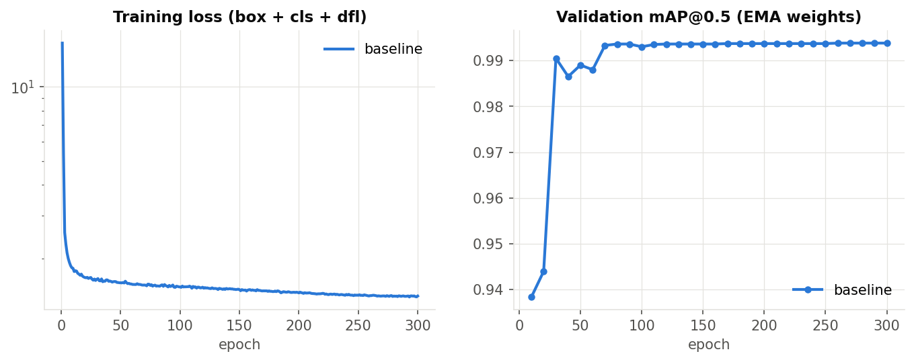

# What we did in Milestone 2, in plain English

**Goal:** take a phone photo of a Braille page and turn it into text. Milestone 1 chose the method
(an object detector, YOLO11-s, that finds every Braille cell and says which of the 63 possible dot
patterns it is) and the data (the Angelina Braille dataset). Milestone 2 asks us to (1) actually train
and run that model, (2) document the setup, (3) present and discuss the results, and (4) propose an
improvement.

---

## 1. How the system works

```
photo  ->  detector (YOLO11-s)  ->  one box + one dot pattern per cell  ->  lines & words  ->  lookup table  ->  text
```

- **The model's job** is the hard part: finding hundreds of tiny cells (about 22 x 33 pixels each) on
  a curved, unevenly lit page and deciding which of the six dots are raised. Each pattern is a number
  from 1 to 63 (dot *i* raised adds 2^(i-1)); for example dots 1-3-4-5 = 29 = the letter "n".
- **Turning patterns into text is not learned.** Grade-1 Braille is a one-to-one code, so after the
  model, ordinary code groups the boxes into lines (by height), splits words where the gap is wider
  than about one empty cell, and looks each pattern up in the standard Braille table (taken from the
  Angelina dataset author's code; Russian and English alphabets, plus the number sign and capital signs).

## 2. The data

**Angelina Braille Images Dataset v1.1** (Ovodov, 2021): 334 phone photos with a box and a dot-pattern
label for every cell, used with the author's official split.

| Split | Contents | Photos | Cells |
|---|---|---|---|
| Train | 169 book pages + 22 handwritten sheets + 44 pages with no Braille (negatives) | 235 | 57,551 |
| Validation | 43 book pages + 6 handwritten sheets | 49 | 14,699 |
| Test | 50 random photos uploaded by real users of the Angelina Reader app | 50 | 13,013 |

We checked that no image appears in two splits (identical-file check by hash).

**Preprocessing:** every photo is resized so the page is 1,024 pixels wide (87 % of the photos already
are), which makes a typical cell about 22 pixels wide. For training we cut random 640 x 640 crops at that
resolution instead of shrinking whole pages, because shrinking would make each dot only ~3 pixels.

**Augmentation (label-safe):** small rotation (+-3 deg), zoom 0.75-1.25x, colour/brightness jitter,
occasional blur. **No mirror flips and no upside-down flips**, because flipping a cell changes which
dots are raised (an "e" would become an "i") and turns raised dots into dents.

## 3. The model

**YOLO11-s**, written from scratch in TensorFlow/Keras (the team asked for TensorFlow; the official
YOLO11 code is PyTorch only). It has 9.48 million parameters, the same as the original:

- a **backbone** that picks out small patterns (edges, bright and dark dots),
- a **neck** that combines fine detail with the wider view,
- a **head** that, for every small area of the image, predicts "is there a cell here, which of the 63
  patterns, and where exactly are its edges",
- **NMS** clean-up that removes duplicate boxes on the same cell.

Because there are no TensorFlow versions of the pretrained (COCO) YOLO11 weights, the model was trained
**from scratch**. This is a change from the Milestone-1 plan, which said "fine-tune COCO weights".

## 4. Experimental setup (run configuration)

| Setting | Value |
|---|---|
| Hardware | NVIDIA RTX 2060 laptop GPU (6 GB), mixed precision (float16) + XLA compilation |
| Training input | 640 x 640 crops of pages at width 1024; 4 crops per training image per epoch (118 steps) |
| Batch size | 8 |
| Epochs | 300 (about 85 minutes; ~16 s per epoch after a ~2 min compile) |
| Optimiser | AdamW, peak learning rate 0.002, 3 warm-up epochs, cosine decay to 1 % |
| Weight decay / gradient clipping | 0.05 (not on BatchNorm or biases) / global norm 10 |
| Weight averaging | Exponential moving average (decay 0.9999, ramped), used for evaluation |
| Loss | YOLOv8/11 loss: task-aligned assignment, classification BCE (x0.5), CIoU box loss (x7.5), distribution focal loss (x1.5) |
| Augmentation | zoom 0.75-1.25, rotation +-3 deg, HSV jitter (0.015 / 0.7 / 0.4), blur 15 %, no flips |
| Model selection | Every 10 epochs on the validation set; keep the checkpoint with the best mAP@0.5 |
| Confidence threshold | Chosen on validation (0.30), then frozen for the test set |
| Early stopping | **Not used** (planned in Milestone 1; see section 9) |
| Seed | 0 (single run) |

**Metrics:** mAP@0.5 and mAP@0.5:0.95 (detection), macro-F1 over the 63 patterns (rare patterns count as
much as common ones), and **character precision / recall / F1 with Ovodov's rule**: a prediction counts
if it overlaps a labelled cell by IoU >= 0.5 and has the right pattern. We added a second, more lenient
rule, **centre-in-box** (the predicted cell's centre lies inside the labelled cell and the pattern is
right); section 6 explains why.

## 5. Results



The training loss keeps falling, and the validation score climbs quickly and is flat from about epoch 80.
That is a **plateau, not overfitting** (validation never got worse), but it means about 200 of the 300
epochs were unnecessary.

| | Validation (49 book pages) | Test (50 real user uploads) |
|---|---|---|
| mAP@0.5 | 0.994 | 0.791 |
| mAP@0.5:0.95 | 0.890 | 0.152 |
| Character precision / recall | 0.9993 / 0.9993 | 0.881 / 0.825 |
| **Character F1 (Ovodov's rule)** | **0.9993** | **0.852** |
| Character F1 (centre-in-box rule) | 0.9994 | 0.948 |
| Macro-F1 (63 patterns) | 0.998 | 0.760 |
| Correct pattern, among cells found | 99.95 % | 99.1 % |
| Time per page (GPU) | 70 ms | 72 ms |

**Discussion**

- On pages like the training data, the model is essentially perfect, and slightly above the published
  result for this dataset (Ovodov's RetinaNet: character F1 0.998). Note that his number was measured
  under his own setup, so it is a reference point rather than a strict head-to-head.
- On real user uploads the official score drops to 0.852. **When the model finds a cell, it reads the
  pattern correctly 99 % of the time**; the drop is almost entirely about *finding and placing* cells.
- A reading check with real text is in `results/reading_check/reading_check.html`: for each page it shows
  the photo, the letters the model read, the model's text next to the true text, and the differences.
  Example: a page the official metric scores at 0.215 actually has only 2.2 % wrong characters in its text.

## 6. Why the test score is lower (failure analysis)

1. **The test labels draw boxes differently.** On the test set, the human labellers drew narrower
   boxes (from the centre of the left dot column to the centre of the right one) than on train/val (around
   the whole cell). Our boxes are in the right place but wider, so their overlap with the label is
   right at the 0.5 cutoff and many correct reads are counted as wrong. With the centre-in-box rule the
   test F1 is 0.948 instead of 0.852. This is an artefact of the labels, so we report both numbers and did
   **not** shrink our boxes to match the test set (that would be tuning on the test set).
2. **Some pages are lit from below.** Raised dots then cast shadows like dents, and the model learned to
   ignore dents (on two-sided book pages, dents are the unlabelled back side). On the worst page it found
   only 47 of 223 cells.
3. **One test page appears mislabelled** (labels shifted by many cells from the visible Braille).
4. **Ambiguous single-column cells:** a lone column of three dots can be dots 1-2-3 or 4-5-6
   depending on where the cell grid is; table borders were read as the wrong one.

Along the way we made and corrected three wrong guesses, which is worth knowing for the write-up:
we first thought test cells were *smaller* (they are larger; that came from the narrow label boxes),
then that dent pages were *upside down* (rotating them never helped; they are lit from below), and an
early rotation test forgot that rotating a cell also changes its dot pattern.

## 7. Improvement, part 1: smarter reading at test time (done, no retraining)

**What it does** (`src/inference.py`):

- **Cell-size check.** Read the page once, measure the typical cell width, and if the cells are outside
  the size range the model handles well (about 16.5-34 pixels), resize the page so cells are ~22 pixels
  and read it again.
- **Lighting check.** Also read a vertically flipped copy (which makes dots lit from below look raised),
  convert the patterns back, and use it only if it finds at least twice as many confident cells.
  The 2x safety margin matters because two-sided pages always show some "text" from the back.
- **English capitals** are now decoded (dot 6 = capital letter, doubled = whole word in capitals).

**Results**

| | Val F1 | Test F1 (official) | Test F1 (centre-in-box) | English book photos: real words |
|---|---|---|---|---|
| Before | 0.9993 | 0.852 | 0.948 | 64.8 % / 68.5 % |
| After | 0.9993 (no harm) | 0.852 | **0.955** | **95.6 % / 93.0 %** |

On the Angelina test set the gain is small (its main problem is the label style, which reading can't
change). On the English book photos it is large. Those photos put a cell at only ~13.5 pixels once
shrunk to 1,024 wide; reading them at the right size turns "pr a / pre aceato he first editio o" into
"Preface / A preface to the first edition of «Jane Eyre» being unnecessary, I ga5…".

**Image preprocessing does not help.** We tried 11 variants (grayscale, contrast stretch, two gammas,
two CLAHE strengths, lighting flattening, sharpening, denoising) at three sizes. They change the share of
real English words by at most +-3 points, while choosing the right size moves it from ~69 % to ~94 %
(`results/preprocess/`).

## 8. Improvement, part 2: proposed (needs the English data)

The remaining errors on English pages are mostly the letter **"v"**: the training data is Russian, and
the dot pattern for "v" (1-2-3-6) **never appears in it** (0 examples; "y" has 5). No reading trick can
produce a pattern the model has never seen. The fix, as planned in Milestone 1:

1. Download the 1,731 English book photos (Kaggle, Zuev 2021). Their full text is known (*Jane Eyre*,
   *The Scarlet Letter*).
2. Read them with the current model, line up the detected cells with the known Braille text of the
   book, and use the alignment to correct wrong patterns and fill in cells the model missed
   (Zuev's method). This produces English training labels without manual work.
3. Retrain on Angelina + English pages with wider zoom and stronger phone-photo augmentation, and with
   **early stopping** (stop when validation hasn't improved for 30 epochs; at most 150 epochs).
4. Measure character error rate on one English volume that is never used for training.

**Other models that could be used instead of / alongside YOLO11-s**

| Model | Why it might help | Trade-off |
|---|---|---|
| RetinaNet (ResNet-50 FPN) | The published Angelina model; a direct comparison | Heavier and slower |
| YOLO11-m / YOLOv8-s | Same pipeline; bigger model or the previous generation | YOLO11-m may not fit 6 GB at full resolution |
| RT-DETR / RF-DETR | Transformer detectors with no NMS step | Usually weaker on tiny objects, need more data |
| Faster R-CNN (FPN) | Strong small-object detector, classic two-stage reference | Slower; region proposals unnecessary when cells never overlap |
| Dot heatmap (U-Net / CenterNet) + grid assembly | Finds individual dots, robust to blur; handles single-column cells via the grid | Needs custom grouping code |
| CRNN + CTC on text lines | Reads a whole line as text; could train from plain book text without boxes | Needs line detection; loses per-cell boxes |

## 9. Known problems for later

**Model and data**
- English-only patterns are missing from training (the "v" problem). Phase 3 fixes it.
- Single-column cells are ambiguous (1-2-3 vs 4-5-6).
- Only two photo sources, so robustness to arbitrary photos is unproven. Stronger augmentation and a small
  set of our own varied photos would show it.
- Trained from scratch; one seed only; no early stopping.

**Reading and text**
- Pages photographed from the back (mirrored) are not handled.
- Lines are assumed roughly horizontal (strong curl or tilt would break line grouping).
- Punctuation tables follow Russian conventions, so English "?" and quotes come out wrong.
- No grade-2 (contracted) English.
- No spelling correction ("ne5r" could become "never" using the model's own probabilities and a dictionary).
- The language has to be chosen by hand.

**Evaluation**
- The validation set is too easy (0.999) to compare models.
- The test labels' box style penalises correct reads, so both scores must be reported.
- No English character-error-rate yet.

**Engineering**
- The web app is local only and does not accept HEIC (iPhone) photos.

## 10. Where things are

| Want to see | Look at |
|---|---|
| Run configuration and training log | `results/baseline/config.json`, `results/baseline/log.csv`, `results/baseline/train_log.txt` |
| All numbers, both inference modes | `results/figures/summary.csv`, `results/baseline/eval_plain/`, `results/baseline/eval_auto/` |
| Plots | `results/figures/` (training curves, per-class F1, most frequent errors) |
| Pages with model text vs true text | `results/reading_check/reading_check.html` |
| Preprocessing study | `results/preprocess/results.csv`, `results/preprocess/variants_sheet.jpg` |
| Try it on your own photo | `python3 app/server.py`, then open http://127.0.0.1:8000 |
